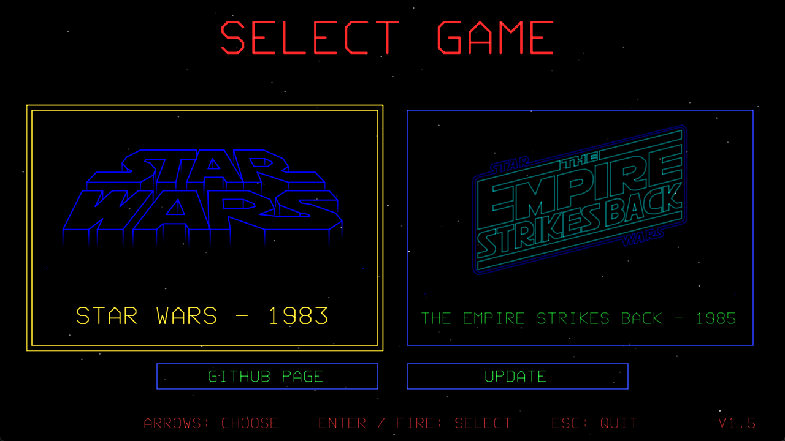
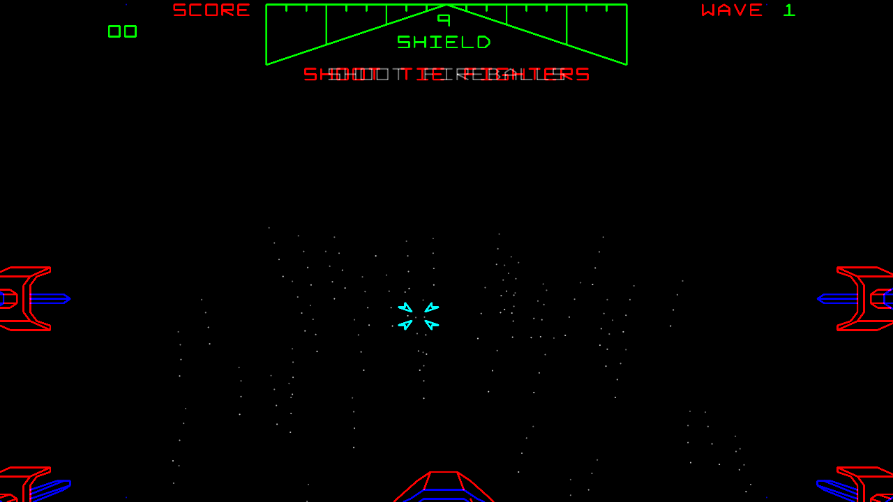
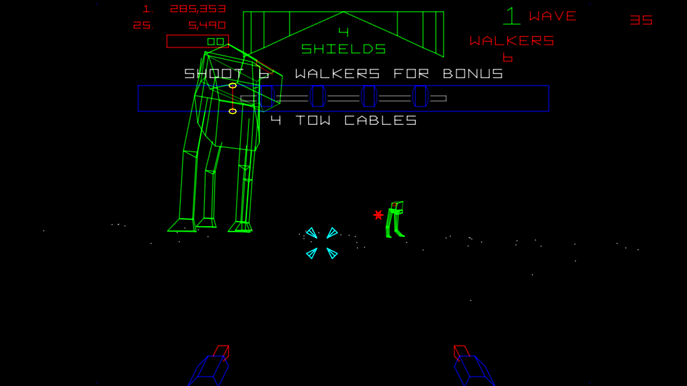
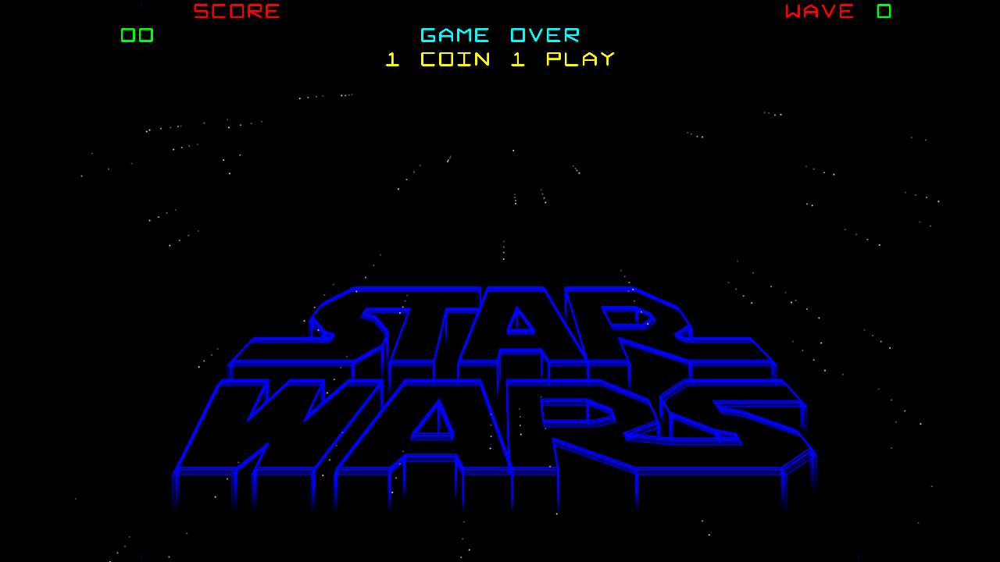
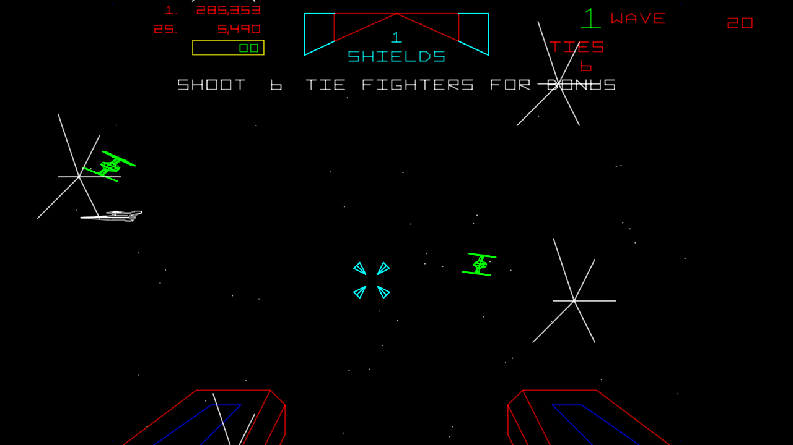
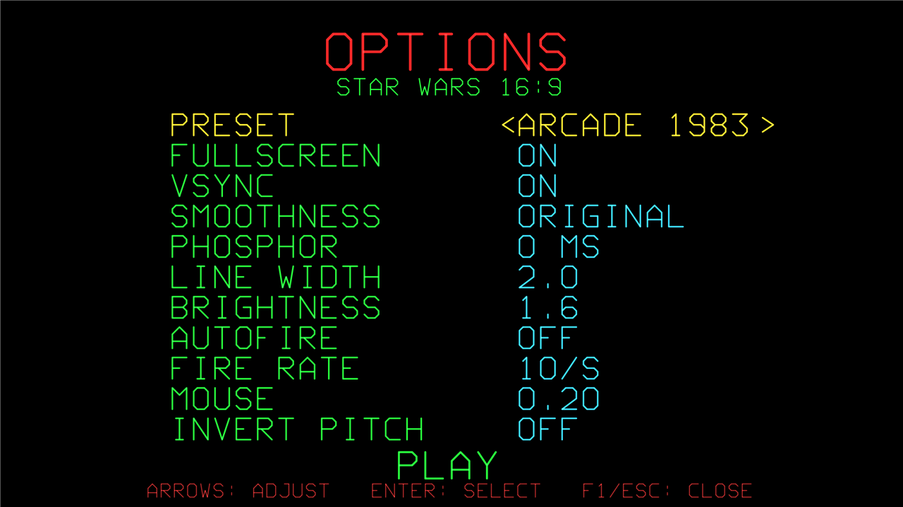

# Star Wars & The Empire Strikes Back — Widescreen 16:9 Edition

Atari's vector arcade classics, **recompiled for modern PCs**: a true 16:9
field of view (not a stretched 4:3 picture), a vector-drawn options menu in the
games' own style, 120 Hz+ smoothness, autofire, full controller support, and a
vector game-selection page.

- **Star Wars (1983)** runs on the [C port](c_src/README.md) of this
  repository: Atari's 6809 program translated to C.
- **The Empire Strikes Back (1985)** runs its original ROM on emulated 6809
  cores ([`esb_src/`](esb_src/README.md)), behind the same PC engine.

> **No ROMs are included.** You must supply your own MAME ROM sets and place
> them yourself in the `roms` folder of each game (see
> [Installing your ROMs](#installing-your-roms)).

## Download

A ready-to-play package (the three programs, documentation and empty `roms`
folders — **no ROMs**) is on the [Releases](../../releases) page. Unzip it
anywhere, add your ROM sets, run `Star Wars Arcade - Selection.bat`.

**Requirements:** Windows 10 or 11 (64-bit), a graphics card with OpenGL 3.3.
The Visual C++ runtime DLLs are included next to each program. The programs
are not code-signed: Windows SmartScreen or an antivirus may ask you to
confirm the first launch.



| Star Wars — 16:9 cockpit | The Empire Strikes Back — AT-AT walkers |
|---|---|
|  |  |
|  |  |



## Features

| | |
|---|---|
| **True 16:9** | The games' own field is widened: 3D objects, stars and lasers use the full width, the cockpit guns sit at the edges of the wider picture, lasers start from the moved guns. |
| **Vector options menu** | Press **F1** (also shown at launch). Drawn with the game beam and an AVG-style stroke font. |
| **Presets** | `ARCADE 1983` (original timing, no phosphor trail, no autofire) and `MODERN PC` (120 Hz+ presentation, short phosphor trail, autofire). Any change shows `CUSTOM`. |
| **Smoothness** | `DISPLAY 120HZ+` redraws at the monitor's refresh rate and recomputes the phosphor decay every frame; game speed is unchanged. |
| **Autofire** | Hold a trigger to fire repeatedly; rate 1–30 shots/s. |
| **Controllers** | Mouse, keyboard, gamepads and flight yokes (GRS Star Wars Flight Yoke included). Every connected controller is read; buttons are remappable in the `.ini`. |
| **Game selection page** | Both title logos, framed, drawn as vectors, with the Star Wars attract-mode theme playing in a loop. The logos and the music are produced by the games themselves on first run, so the page contains no ROM data. |
| **Fullscreen** | Both games and the selection page start in borderless fullscreen (**Alt+Enter** toggles). |
| **Clean audio** | XAudio2 stream fixed (no crackle). |

## Installing your ROMs

Use your own, legally obtained **MAME** ROM sets, as zip files. Chips are
recognised by their CRC, as MAME does, so older sets with different file names
work too. Nothing is ever written to your zips: every 16:9 change is applied in
memory when the game loads.

| Game | MAME set | Put it here |
|---|---|---|
| Star Wars | `starwars` (revision 2, or revision 1 `starwars1`) | `StarWars-Arcade/StarWars-16-9/roms/starwars.zip` |
| The Empire Strikes Back | `esb` | `empire strikes back - Arcade/ESB-16-9/roms/esb.zip` |

If a ROM set is missing or incomplete, the game says which file it expected and
where.

## Folder layout (ready to play)

```
Star Wars Arcade - Selection.bat         <- start here
Selection/
    selection.exe   selection.ini
StarWars-Arcade/
    Star Wars (16-9 natif, port C).bat
    StarWars-16-9/
        sw_win.exe  sw_win.ini
        roms/starwars.zip                <- your ROM set
empire strikes back - Arcade/
    Empire Strikes Back (16-9 natif).bat
    ESB-16-9/
        esb.exe     esb.ini
        roms/esb.zip                     <- your ROM set
```

## Controls

| Action | Mouse | Keyboard | Controller (Windows button no.) |
|---|---|---|---|
| Aim (yoke) | move | arrow keys | stick |
| Fire (triggers) | left button · Star Wars: right button too | Left Ctrl, Alt | 1, 2 |
| Thumb buttons — Star Wars: fire · **ESB: tow cable** | ESB: right & middle buttons | Space, Shift | 3, 4 |
| Insert coin | — | 5 | 7 |
| Options menu | — | F1 | — |
| Quit | — | Esc | — |

In ESB the **tow cable** is fired from the yoke's thumb buttons, exactly as on
the cabinet; autofire never applies to them, so a held button does not spend
all four cables.

### Remapping a controller

In `sw_win.ini` / `esb.ini`, section `[joystick]`:

```ini
ignore=ROCCAT            ; device names to skip, ';'-separated (e.g. a mouse dock that poses as a joystick)
button_fire_r=1          ; numbers as shown in Windows' "Game Controllers" panel, 0 = none
button_fire_l=2
button_thumb_r=3
button_thumb_l=4
button_coin=7
deadzone=19
```

## Building

Visual Studio 2022 (Build Tools are enough), x64:

```
cmd /c c_src\build_win_bt.bat           -> c_src\sw_win.exe     (Star Wars)
cmd /c esb_src\build_esb.bat            -> esb_src\esb.exe      (The Empire Strikes Back)
cmd /c selector_src\build_selector.bat  -> selector_src\selection.exe
```

`build_win_bt.bat` is `build_win.bat` pointed at the VS 2022 *Build Tools*
install; use `build_win.bat` with the Community edition.

## How the 16:9 widening works

Full details, addresses and values: [Star Wars changes](docs/widescreen/PATCHES-16-9.md)
· [The Empire Strikes Back changes](docs/widescreen/PATCHES-ESB-16-9.md).

**Star Wars** (C port, see [`c_src/`](c_src/README.md)):

- object clamp `VGEDG` ±510 → ±680, laser origins `VGLIM` ±480 → ±730,
  new HUD anchors `VGHUD` ±650 (score and wave stay on screen);
- star visibility cone widened ×4/3;
- 16:9 picture space in the renderer;
- cockpit guns: the four `VOFF` words of the vector ROM set to ±650, in memory.

**The Empire Strikes Back** (real ROM, see [`esb_src/`](esb_src/README.md)):

- the board's extra hardware: second ROM bank at `$A000`, the **137412-101
  Slapstic** protection chip (state machine from MAME), 64K sound map;
- the 6809's dead bus cycles in indexed addressing, also from MAME: the
  Slapstic's alternate bank sequence (`$9Exx`, `$FFFF`, `$9B5x`) is keyed on
  them, and the game crashes without them;
- in memory: object clamp ±680, star cone ×1.31 (a 25-byte 6809 routine in free
  ROM space), snowspeeder and space-phase guns moved to 4/3 of their offset,
  laser-origin table moved with them.

## Credits and license

- Disassembly, C port, emulator twin and PC engine: **Tim Cottrill**
  (this repository's upstream). See [README-upstream.md](README-upstream.md) (the original project README).
- Slapstic 137412-101 logic and 6809 dead-cycle table: from **MAME**
  (`slapstic.cpp`, `m6809.lst`, BSD-3-Clause; Aaron Giles, Nathan Woods and
  the MAME team).
- Source licenses: see [LICENSE](LICENSE) and the SPDX headers of each file
  (GPL-2.0 / GPL-3.0-or-later, plus the Unlicense/MIT-style vendored files).

*Star Wars* and *The Empire Strikes Back* are trademarks of Lucasfilm Ltd. The
games are © Atari / Atari Games. This is a non-commercial fan project, not
affiliated with or endorsed by Lucasfilm, Disney or Atari. **No ROM data is
distributed**; you need your own ROM sets.
